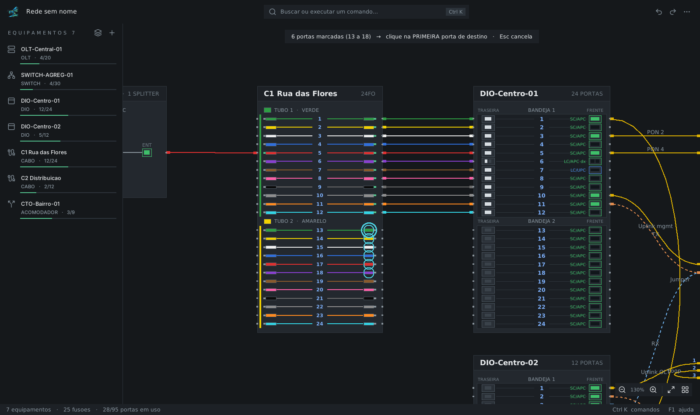

<p align="center"></p>

# WaspFiber

Diagramas de fusão e fibra óptica (FTTX) para Windows: um único `.exe`, sem instalação.



## O que faz

- Cadastra **cabos** (fibras e tubos no código de cores ABNT NBR 14721), **DIOs** (traseira de fusão e frente de conector), **CTO/acomodadores** com splitters PLC e **OLT / switch / RB** com placas e grupamentos.
- Desenha cada equipamento como ele é: DIO e OLT em pé, com as portas alinhadas às fibras do cabo.
- Tipos de porta **SC/LC** e **APC/UPC** (APC verde, UPC azul); portas **duplex** (sempre LC).
- Fusão por clique, ou **várias de uma vez** (clique na primeira, Shift+clique na última, clique no destino).
- **Rastreio** do caminho da fibra com perda em dB e potência estimada em cada ponta.
- **Pendências** (splitter sem entrada, duplex pela metade, nomes repetidos) e **capacidade** (portas livres).
- **Tudo no servidor**: login por empresa; cidades e diagramas (POPs, caixas de emenda e CTOs) ficam no Servidor WaspFiber (`servidor/`), com histórico de versões, aviso quando duas pessoas salvam o mesmo diagrama e envio automático do que foi salvo sem conexão.
- **App Android** (pasta \ndroid/\, Kotlin): o técnico entra com o e-mail da empresa, vê o mapa da cidade com os POPs, CEOs e CTOs e a própria posição (GPS), e cria ou corrige equipamentos pelo GPS. Mesmo servidor e mesmos dados do programa de PC.
- **Localização no mapa**: cada diagrama é um POP, caixa de emenda ou CTO com coordenada — mapa (ruas/satélite) dentro do programa, sem chave nem custo, cola coordenada ou link do Google Maps, abre no **Google Maps** e no **Google Earth**.
- Paleta de comandos (**Ctrl+K**), desfazer/refazer, recuperação automática.
- Exporta diagrama em PDF/SVG/PS, relatório PDF completo e CSV para o Excel.

## Como rodar

Só precisa do Python 3.8+ com tkinter (já vem no Windows). Nenhuma dependência externa.

```
python waspfiber.py
```

Autoteste (sem abrir janela): `python waspfiber.py --autoteste`

## Gerar o executável

No Windows, rode `build_windows.bat` (usa PyInstaller) — o resultado sai em `dist\WaspFiber.exe`.

## Testes

```
python teste_core.py          # modelo, rastreio, busca, exportações
xvfb-run -a python teste_gui.py   # interface (Linux) ou: python teste_gui.py
```

## Arquivos

| Arquivo | O que é |
|---|---|
| `waspfiber.py` | modelo, desenho, exportações e janela |
| `waspfiber_ui.py` | botões, menus, cartões, paleta |
| `waspfiber_icones.py` | ícones (Lucide, licença ISC) e logo embutidos |
| `waspfiber.ico` | ícone do executável |
| `LEIA-ME.txt` | manual de uso e histórico de versões |

Versão atual: **B0.32** (beta).
